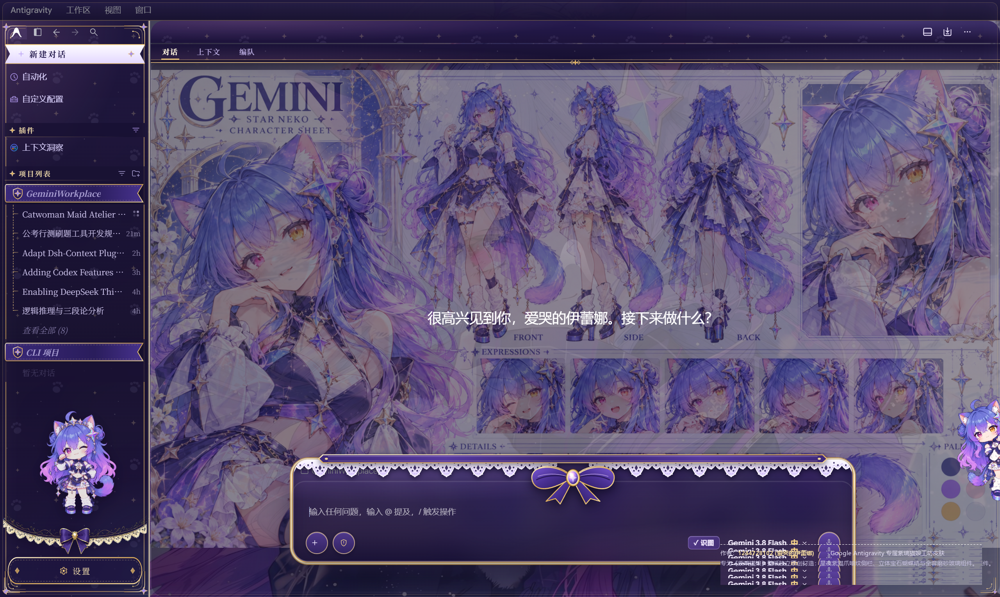

<p align="center">
  
</p>

<h1 align="center">Zili Neko Atelier · 紫璃猫娘 (<code>agy-atelier</code>)</h1>

<p align="center"><b>Turn Google Antigravity into a Starry Violet Rococo Maid Atelier — zero file patching, one-click live DevTools injection.</b></p>

<p align="center">🥇 <b>The most complete full-window glassmorphism skin & live telemetry header console for Google Antigravity (AGY)</b> 🥇</p>

<p align="center">
  <a href="./README.zh-CN.md">简体中文</a> ·
  <a href="./INSTALL.md">Install Guide</a> ·
  <a href="./AGENTS.md">Architecture</a> ·
  <a href="./CHANGELOG.md">Changelog</a>
</p>

<p align="center">
  <a href="https://github.com/1244728102"></a>
  
  
  <a href="LICENSE"></a>
</p>

---

**Zili Neko Atelier (`agy-atelier`)**专为紫发异瞳猫娘立绘壁纸《紫璃猫娘》独立原创深度定制，由 **1244728102 (爱哭的伊蕾娜)** 全案设计。它不仅将 Antigravity 的侧边栏、底部对话输入栏、消息气泡与顶部标题栏重塑为统一的**「紫璃罗兰紫 · 薰衣草粉紫 · 香槟柔金」**半透明磨砂玻璃体系，还在顶栏内联集成了**实时 Token 上下文环形图**与**多 Agent 编队拓扑控制台**。

## ✨ 核心亮点 (Highlights)

- **🥇 零侵入热注入架构 (Zero-Intrusion Isolated World Injection)**：不修改任何 Antigravity 安装目录文件，无需打包重签名。通过 CDP `Page.createIsolatedWorld` 实时挂载样式与装饰层，随时调用 `atelier_clear` 即可 100% 无损恢复原生界面。
- **🎀 星夜紫罗兰侧栏 + 高精度 U 形刺绣蕾丝**：
  - 侧栏采用星夜紫罗兰磨砂底色 + 猫爪星芒织锦暗纹 + 四角星月金线框；
  - 底部搭载**高精度金色卷草藤蔓 + 镂空刺绣蕾丝花瓣 + 紫璃罗兰紫立体绸缎蝴蝶结 + 珍珠金胸针**（`assets/ornaments/sidebar-swag.webp`），上方衬托 Q 版猫娘吉祥物；
  - 「新建对话」重塑为**陶瓷白燕尾缎带金边按钮**，工作区标题重塑为**紫金燕尾绶带 + 星月盾徽**，会话树自带金色虚线连接轨。
- **💎 1:1 黄金比例居中古典金框对话栏 (`964px × 145px` True-Centered Composer)**：
  - 顶部横跨镶金紫罗兰缎带横梁、三段式精确对齐薰衣草扇贝蕾丝轨道（`[data-skin-chrome="composer-lace"]`），正中央悬挂立体褶皱金边蝴蝶结与星芒宝石；
  - 内胆采用**紫璃罗兰紫 + 樱粉极光**双层径向渐变磨砂玻璃；
  - 左下角并排 `[ + ]` 与 `[ 🛡 ]` 两枚 `38×38px` 金边圆形磨砂徽章；右下角内联 `[ ✓ 识图 ]` 标签、无框模型选择器与 `38×38px` 圆形操作按钮；底部金框正下方外部居中悬浮实时 `tok/s · 缓存命中率` 状态条。
- **🧭 双层星夜紫罗兰控制台顶栏 (Two-Row Telemetry Console Header)**：
  - **第一行**：左侧显示工作区面包屑与 `🔔 标准模式` 胶囊；右侧在不遮挡任何原生控件的前提下集成 `[ ▭ 面板切换 ]`、`[ ⤓ 一键导出对话 Markdown ]`、`[ ⋯ ]`、`[ ◨ ]` 4 枚图标按钮；
  - **第二行**：左对齐 `对话 | 上下文 | 编队` 三栏切换标签，底沿贯穿双金线与中央微星菱形饰（`──◇✦◇──`），点击即可就地展开 8 维 Token 账单环形图、步级趋势图与多 Agent 编队协作时间线。
- **🖼️ 零遮挡立绘保护区**：自动隐藏右上角遮挡猫娘脸部的“概览 / 已上传文件”浮层面板，并自动清除对话容器 `336px` 右内边距偏移，确保正文列（`898px`）与底部对话栏（`964px`）严格处于对话区几何中心。

---

## 📸 实机运行截图 (See it work)

### 全窗口实机效果（星夜紫罗兰侧栏 + 双层控制台顶栏 + 居中金框蕾丝对话栏）


---

## 🚀 快速安装 (Installation)

### 方式一：一行命令克隆至 Antigravity 插件目录

**Windows PowerShell**:
```powershell
git clone https://github.com/1244728102/agy-atelier.git "$env:USERPROFILE\.gemini\config\plugins\agy-atelier"
```

**macOS / Linux**:
```bash
git clone https://github.com/1244728102/agy-atelier.git "$HOME/.gemini/config/plugins/agy-atelier"
```

### 方式二：直接发给你的 AI 代理自动安装

将下面这句话直接发给 Antigravity / Claude Code / Codex：

> 请按照 https://github.com/1244728102/agy-atelier/blob/main/INSTALL.md 安装并启用 `agy-atelier` 紫璃猫娘工坊皮肤插件，然后调用 `atelier_apply` 注入当前窗口。

---

## 🛠️ MCP 工具与配置面板 (MCP Tools & Configuration)

安装后，插件在启动时会自动通过 `server/mcp_server.py` 将保存的皮肤配置注入当前 Antigravity 窗口。你也可以随时通过右侧辅助面板「专属壁纸」或以下 4 个 MCP 工具进行动态控制：

| 工具名 | 功能说明 | 参数说明 |
| :-- | :-- | :-- |
| `atelier_open_ui` | 在右侧辅助面板打开可视化调参工作台 (`ui://agy-atelier/app.html`) | 无 |
| `atelier_apply` | 将壁纸、磨砂玻璃与蕾丝皮肤实时热注入当前窗口 | `themeMode` (`dark`/`light`), `opacity` (`0.2~1.0`), `blur` (`0~30`), `accent` (`#b69cf5`), `showLace` (`true`/`false`), `wallpaperPath` |
| `atelier_clear` | 从当前窗口卸载全部注入节点与样式，100% 恢复原生外观 | 无 |
| `atelier_status` | 检查当前壁纸皮肤配置与窗口注入激活状态 | 无 |

---

## 📂 项目文件结构 (Repository Layout)

```text
agy-atelier/
├── plugin.json                        # Antigravity 插件清单与唤醒词 (v0.2.0)
├── mcp_config.json                    # MCP Server 进程启动配置
├── README.md                          # 主产品文档（中英双语导览）
├── README.zh-CN.md                    # 简体中文详细手册
├── INSTALL.md                         # 面向人类与 AI 代理的安装指南
├── AGENTS.md                          # 面向 AI 代理的架构说明与二次开发指南
├── CHANGELOG.md                       # 版本演进记录
├── NOTICE.md                          # 致敬与开源许可声明
├── LICENSE                            # MIT 开源许可证
├── assets/
│   ├── demo-full-window.png           # 实机全窗口高清预览图
│   ├── wallpaper.jpg                  # 《紫璃猫娘》紫发异瞳猫娘壁纸
│   ├── logo.png                       # 紫璃猫娘工坊 Q 版徽标
│   └── ornaments/                     # 高精度蕾丝、蝴蝶结、三切片/九切片金框贴图资源
├── server/
│   ├── mcp_server.py                  # Python MCP App 服务端 + 127.0.0.1:5399 遥测桥 + 启动自动注入
│   └── injector.mjs                   # DevTools Isolated World 零侵入样式与 DOM 注入引擎
├── skills/
│   └── agy-atelier/
│       └── SKILL.md                   # /agy-atelier 技能触发指令手册
└── ui/
    ├── app.html                       # 侧栏交互式调参面板 (MCP App UI)
    └── ext-apps.js                    # MCP Ext-Apps 前端通信运行时
```

---

## 📜 开源许可 (License)

- 本插件由 **1244728102 (爱哭的伊蕾娜)** 原创设计与开发，采用 **[MIT License](./LICENSE)** 开源。
